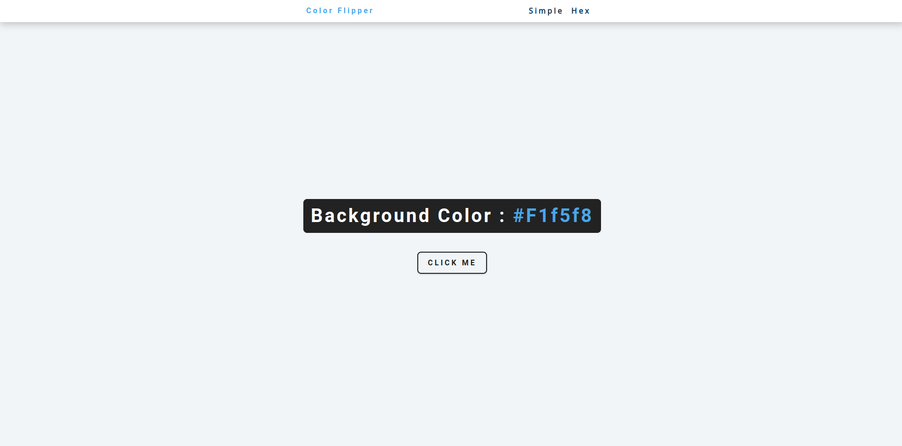

# Cores Aleatórias

🔗 **Demo:** https://silviofjr.github.io/cores-aleatorias/

Este é um simples aplicativo de gerador de cores aleatórias desenvolvido em HTML, CSS e JavaScript. O aplicativo gera cores aleatórias de forma dinâmica e permite que você veja o código RGB/hexadecimal da cor.

## Funcionalidades:

- Geração de cores aleatórias com um único clique.
- Exibição do código RGB/hexadecimal da cor gerada.

## Tecnologias utilizadas:

- HTML
- CSS
- JavaScript

## Como usar:

1. Acesse a [demo](https://silviofjr.github.io/cores-aleatorias/) ou clone o repositório e abra o `index.html` no navegador.
2. Selecione o formato do código da cor (RGB ou HEX).
3. Clique no botão "CLICK ME" para obter uma cor aleatória.
